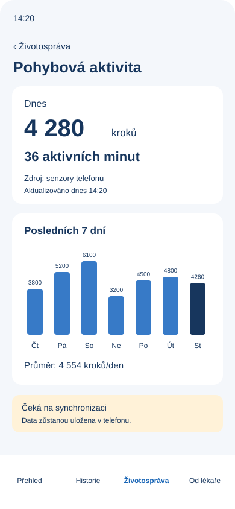

# GUI-31 – Pohybová aktivita

Vstup: Životospráva → Pohybová aktivita. Návrh, syntetická data.

```text
‹ Životospráva       Pohybová aktivita
Dnes
        4 280 kroků
        36 aktivních minut
Zdroj: senzory telefonu
Aktualizováno: dnes 14:20
Posledních 7 dní (kroky)
Čt  3 800  ███████
Pá  5 200  ██████████
So  6 100  ████████████
Ne  3 200  ██████
Po  4 500  █████████
Út  4 800  █████████
St  4 280  ████████
Průměr: 4 554 kroků/den
Stav: čeká na synchronizaci
Přehled | Historie | Životospráva | Od lékaře
```

- 31a: Oprávnění chybí – vysvětlení účelu, možnost otevřít nastavení; ostatní funkce dostupné.
- 31b: Data nejsou dostupná – zobrazit pomlčku a čas posledního dostupného údaje, nikoli nulu.
- 31c: Zařízení nepodporuje potřebný údaj – vysvětlit omezení, zobrazit dostupné metriky.
- Offline: zobrazit poslední dostupné údaje a jejich stáří, čekající přenos po obnovení sítě.

Denní souhrn obsahuje kroky a aktivní minuty; žádný automatický cíl, diagnóza ani doporučení. Přesné platformní rozhraní a pravidla aktualizace denního souhrnu se ověří při návrhu implementace.


