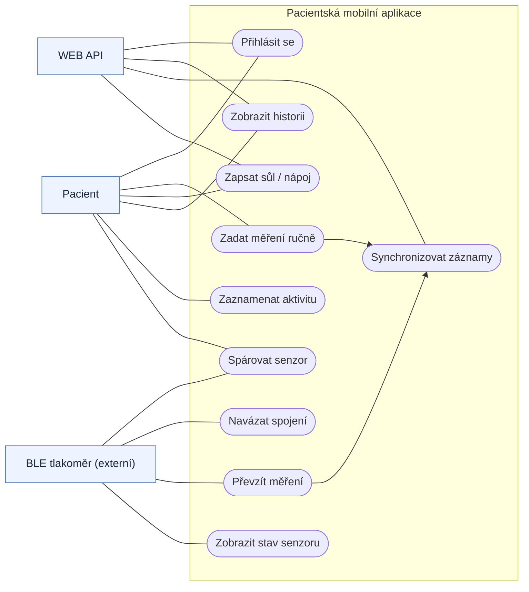
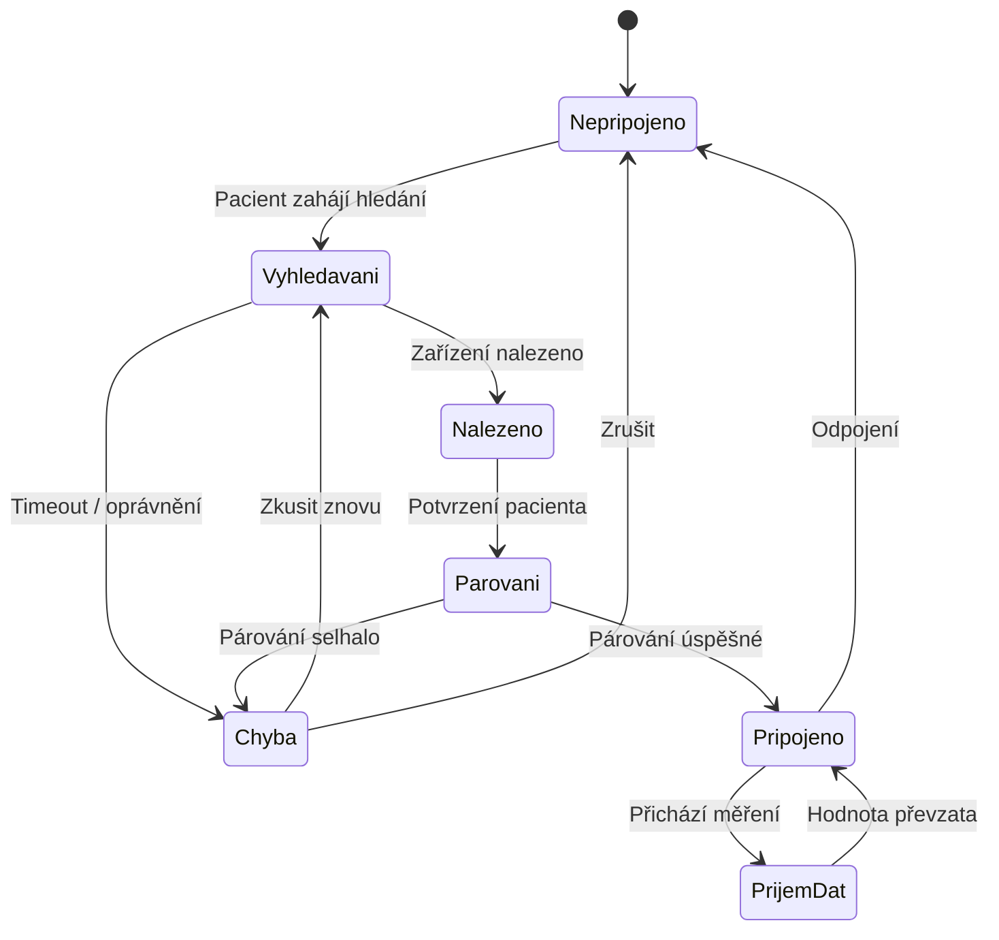
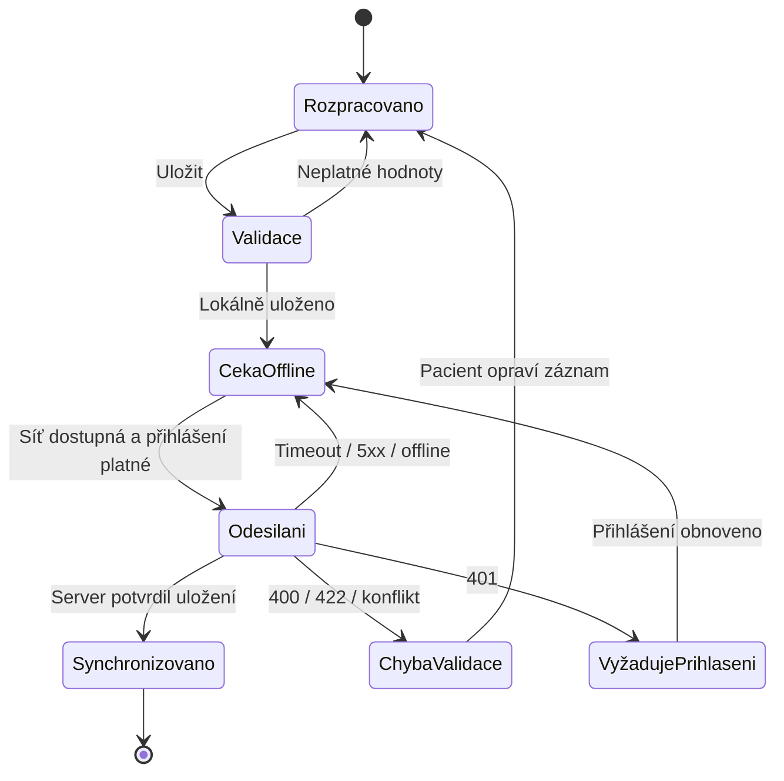
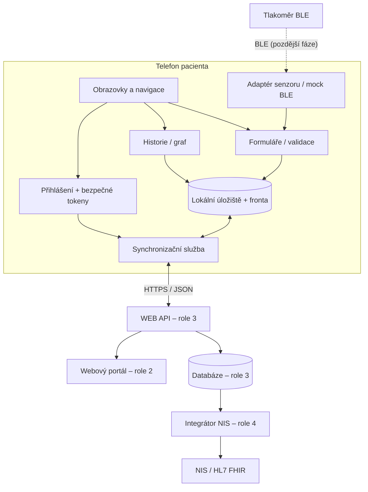

# Diagramy

Soubory `.mmd` lze otevřít v editoru Mermaid a importovat do draw.io (Insert → Advanced → Mermaid). Pro rychlý náhled na GitHubu:

## 01-use-case

## 02-stav-ble

## 03-stav-mereni-sync

## 04-komponenty-mobil

