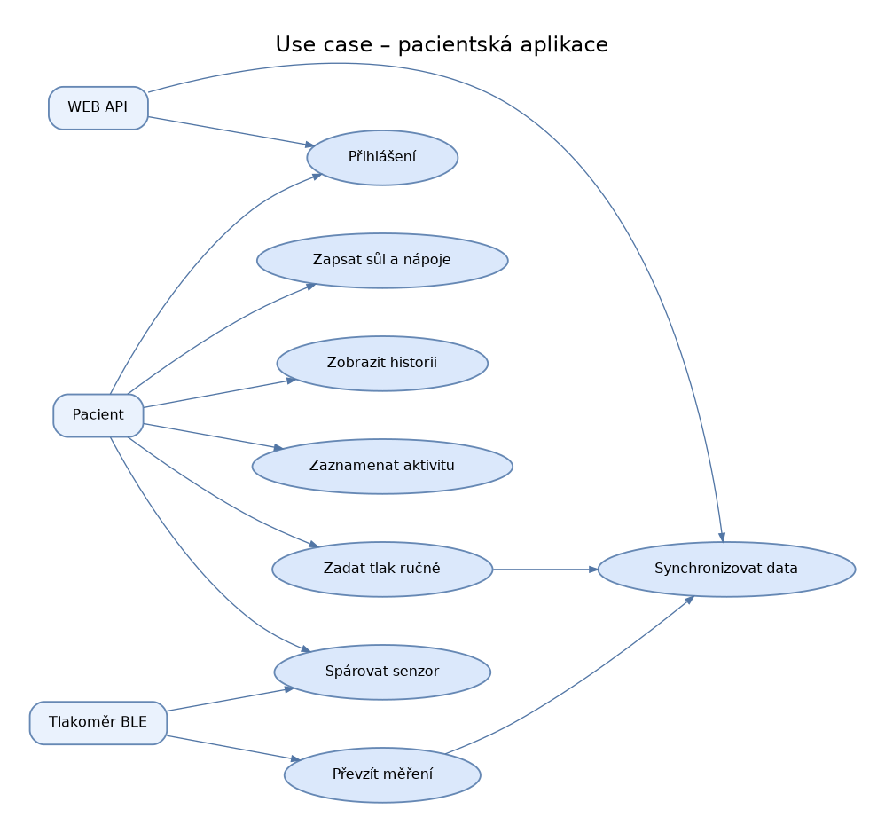
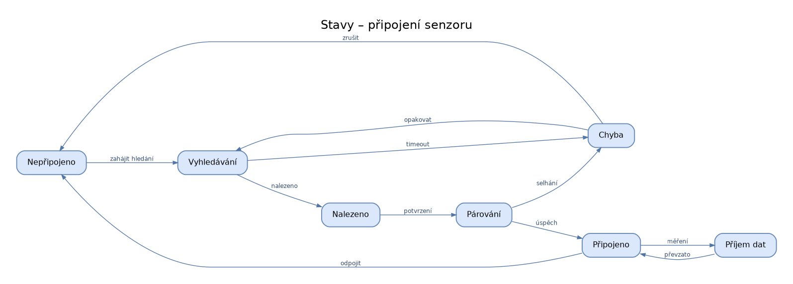
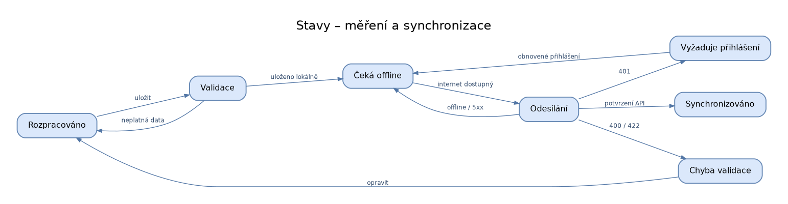
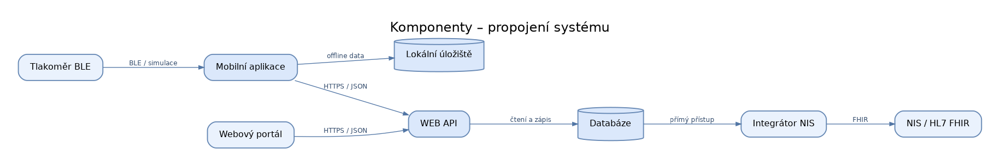

# Vizuální diagramy pacientské aplikace

Diagramy jsou ve třech podobách: **`.drawio`** (editovatelné objekty a šipky v diagrams.net), **`.png`** (rychlý náhled) a **`.svg`** (vektorový obrázek). Původní `.mmd` soubory zůstaly zachovány.

| Diagram | Náhled | Editace |
|---|---|---|
| Use case – pacientská aplikace |  | [01-use-case.drawio](01-use-case.drawio) |
| Stavy – připojení senzoru |  | [02-stav-ble.drawio](02-stav-ble.drawio) |
| Stavy – měření a synchronizace |  | [03-stav-mereni-sync.drawio](03-stav-mereni-sync.drawio) |
| Komponenty – propojení systému |  | [04-komponenty-mobil.drawio](04-komponenty-mobil.drawio) |

Otevření: [app.diagrams.net](https://app.diagrams.net) → File → Open From → Device → soubor `.drawio`.

**Poznámka:** jde o návrh mobilní části. Konkrétní API endpointy a BLE protokol je nutné odsouhlasit s týmem.
